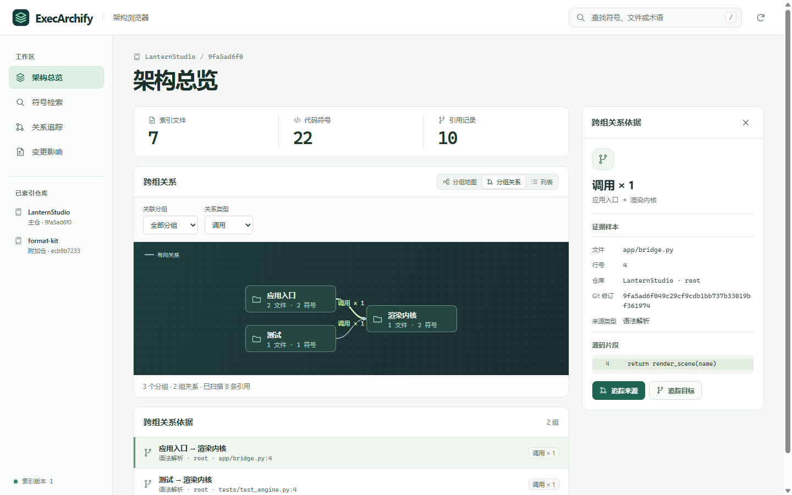

# ExecArchify

在一个 Git 工作树中为 Agent 建立可查询的代码图谱。索引随本地修改更新。命令行、只读 MCP 工具和离线浏览器界面共用一份 SQLite 索引。每次只打开一个主仓，初始化时可以附加明确选定的本地公共仓。

## 快速使用

需要 Python 3.11 或更新版本、带 FTS5 的 SQLite（常见的 CPython 安装已包含）以及命令行 Git。安装发行包时可断开外网。

```sh
python -m pip install --no-index /path/to/execarchify-0.1.1-py3-none-any.whl
cd /path/to/your/repository
execarchify init .
execarchify resolve "normalize"
execarchify trace "src/codec.py#normalize" --direction in
execarchify impact
execarchify serve
```

示例中的名称和路径应替换为当前仓的内容。浏览器入口默认是 `http://127.0.0.1:8765`。也可以直接在本项目根目录运行 `python -m execarchify init /path/to/repository`，其他子命令用 `--workspace /path/to/repository`。这个运行方式只需要 Python 标准库和 Git。

## 自动更新与仓库范围

- `init .` 首次建图，并自动启动本工作树的后台观察进程。持续保存、新建、删除、重命名、改变忽略规则，以及切换分支或拉取提交后，索引会自动收敛到当前工作树。未跟踪且未被 Git 忽略的源文件也在范围内。变更在 SQLite 事务中发布。
- Windows 直接订阅原生目录变更通知。保存时约 150 毫秒合并相邻事件，再启动同步。其他平台可使用 `watchdog` 获取系统事件，未安装时默认每 2 秒轮询。事件模式还会周期核对（默认 15 秒），以覆盖漏掉的事件和工作树外的公共仓变化。同步只读入可能变化的文件，内容摘要相同的文件跳过重解析。
- 查询前也会同步。停止观察或关机期间积累的修改会在下一次使用时补上。`status` 查看观察状态、文件/符号数和数据库位置，`stop` 停止这个工作树的观察进程。`init . --no-watch` 适用于一次性任务，`watch` 可前台运行。
- 数据库和观察状态写入当前 Git 工作树的私有元数据目录。普通仓通常是 `.git/execarchify/index.sqlite3`，链接工作树各自使用自己的数据库。
- `execarchify init . --shared-repo ../shared-lib` 将这个公共仓一同建图。可重复指定。再次 `init .` 留空可恢复仅主仓。只在公共仓运行时，它就是主仓，其他业务的使用者属于分析范围之外。
- 根仓的 Git 子模块 gitlink 或下述 `pins` 提供依赖提交。索引器直接读取对应的 Git 对象，可以与公共仓当前检出的分支不同。只选择路径而缺少固定提交时，公共仓的 HEAD 作为参考版本供搜索，跨仓关系会显示版本缺口。

## 接入 Agent

每个 MCP 进程绑定一个 Git 工作树，通过本地 stdio 提供只读图谱查询。将下面的配置填入客户端，并修改为当前主仓的绝对路径。若客户端找不到 `execarchify`，填写安装环境中可执行文件的绝对路径。需要附加公共仓时，先用 CLI 为主仓选定依赖。

```json
{
  "mcpServers": {
    "execarchify": {
      "command": "execarchify",
      "args": ["mcp", "--workspace", "/absolute/path/to/current/repo"]
    }
  }
}
```

Codex 可在受信任目标仓的 `.codex/config.toml` 中使用下列配置。Windows 虚拟环境中的程序位于 `Scripts/execarchify.exe`。[Codex MCP 配置文档](https://developers.openai.com/codex/mcp/)

```toml
[mcp_servers.execarchify]
command = "/absolute/path/to/execarchify"
args = ["mcp", "--workspace", "/absolute/path/to/current/repo"]
```

| 工具 | 用途 |
|---|---|
| `context` | 空参数核对主仓和公共仓绑定。用 `architecture: true` 查看有证据样本的跨组关系，或传入 `id` 查看一个实体的源码摘录。 |
| `resolve` | 用 `query` 按术语、标识、路径或正文定位代码。可用 `group` 和 `repo` 限定范围。结果包含可继续查询的 ID、匹配原因和源码证据。 |
| `trace` | 从 `id` 或主仓内的 `path#qualified_symbol` 开始，按 `direction` 及 `depth` 追踪。每条边保留证据文件、行、版本、摘要和置信度。 |
| `impact` | 默认比较 HEAD 与工作树，也可指定 `base` 和 `head`。默认传播两跳，返回修改范围、逐跳影响证据、待核候选和相关测试。 |

现代客户端通过 `server/discover` 发现能力，兼容既有客户端的 `initialize` 握手。支持结构化结果的客户端可以读取 `structuredContent`，JSON 文本也会出现在 `content[0].text`。单份查询结果的 UTF-8 JSON 上限为 55,000 字节。触及上限时返回 `response_truncated`，可以缩小查询范围继续取证。架构扫描另有 `group_edges_truncated` 和 `reference_scan_count`。[MCP 工具规范](https://modelcontextprotocol.io/specification/2026-07-28/server/tools)

配套的 [`execarchify` skill](.agents/skills/execarchify/SKILL.md) 可从本仓调用。用于其他仓时，把整个 `execarchify` skill 目录复制到目标仓的 `.agents/skills/`，或复制到用户主目录的 `.agents/skills/` 供多个仓使用。离线 wheel 安装到虚拟环境后，同一目录也可从该环境的 `share/execarchify/skills/execarchify/` 取得。在 Codex 中可用 `$execarchify` 调用。[Codex skill 目录说明](https://developers.openai.com/codex/skills/)

## 给任何项目加上自己的词汇和架构

零配置时按仓库目录分组，使用标识、路径和正文检索。需要团队术语、逻辑架构层或代码隐含的信号关系时，在目标仓根目录添加可版本控制的 `.execarchify.json`。每项都可省略。以下是文档渲染器项目的配置示例。

```json
{
  "terms": {"规格换算": ["normalize", "convert_units"]},
  "layers": [
    {"name": "Runtime", "paths": ["src/runtime/**", "lib/**"]},
    {"name": "Documentation", "paths": ["docs/**"]}
  ],
  "relations": [
    {"from": "src/runtime/codec.py#normalize", "to": "docs/formats.md", "kind": "documented_by", "impact": "none"}
  ]
}
```

分组按第一个匹配规则生效，其他文件按顶层目录回退。关系端点可用主仓路径、`path#qualified_symbol` 或含 `repo`、`path` 和可选 `symbol` 的对象。`impact` 控制改动如何沿这条关系传播。`forward` 从来源到目标，适合发布者到消费者。`reverse`（默认）从依赖对象到引用者。`both` 双向，`none` 只用于追踪。每条声明保留配置文件位置和 JSON 指针。要固定附加仓版本，可以加 `"pins": {"../shared-lib": "<实际提交哈希>"}`。

## 如何理解结果

Python 使用 AST 抽取定义与静态调用位置。JavaScript/TypeScript、Go、Rust、C/C++、Java、C# 使用保守的词法分析，相关边带有 `heuristic` 标记。Markdown、若干配置格式与构建文件提供结构化标题或键。其他受支持编码的文本保留路径、正文和行号，因此文档仓和团队自己的 DSL 也能搜。当前支持不超过 1 MiB 的 UTF-8 文本，以及带 BOM 的 UTF-16/UTF-32 文本。二进制、超限文件和无法读取的输入不会成为源码证据。

`parsed` 表示解析到的源码位置，`inferred` 表示按唯一名称推测的目标，`declared` 表示仓库规则明确声明的关系。动态回调、同名歧义和缺失版本会留下待核项。变更报告指出修改位置与已发现的依赖，真实运行时行为仍由构建、测试或设备观测确认。历史比较按文本变更计算，重命名可以呈现为一删一增。

## 可视化与 Archify

浏览器提供架构分组、带逐跳证据的跨组关系和代码邻域，以及工作树或提交间的影响视图。`export` 可保存标准 UTF-8 的 Archify architecture IR v1，供上游验证或渲染。

```powershell
execarchify export --format archify --output architecture.json
```



从分组关系中选一条边，可以打开调用位置，并继续追踪来源或目标。实现依据与测试方法见 [架构设计](docs/arch/IR20261123163112-内网架构与信号图谱.md)。

## 验证

```sh
python -m unittest discover -s tests -v
```
