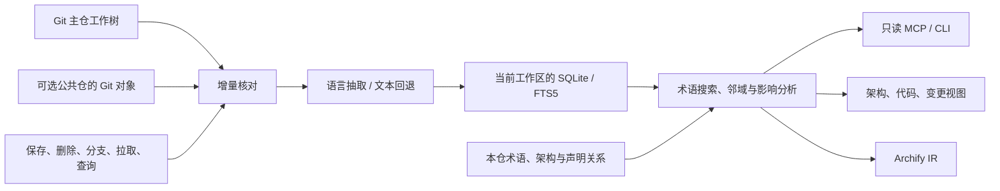

# ExecArchify 通用仓库图谱

## 产品与范围

Agent 在一个 Git 工作树中问“这个概念在哪里实现”“这个调用通向哪里”“这次修改要回归哪些地方”。默认从当前仓的源码、文档与配置回答。业务归属、平台、术语、硬件或信号协议都由目标仓的数据提供。

一个工作区有一个主仓和零到多个显式选中的公共仓。业务 A、业务 B、公共组件各自都是可独立打开的 Git 仓。搜索、追踪、影响报告与实体 ID 都限定在当前主仓的工作区。对某个公共仓单独评审时，可以确定导出接口和仓内调用是否变化，外部使用方需要到对应的业务仓核查。

## 工程依据

四套上游源码已克隆到本项目的 `.upstream/` 下。运行时为独立实现，发行包只包含 ExecArchify。下表给出可复核的提交及本工具采用的做法。

| 来源与修订 | 阅读的实现 | 在 ExecArchify 中的体现 |
|---|---|---|
| CodeGraph · `461a5d87a873` · MIT | [文件监听](https://github.com/colbymchenry/codegraph/blob/461a5d87a873a4932997cd9a49042ab30e45a675/src/sync/watcher.ts)、[标识符拆词](https://github.com/colbymchenry/codegraph/blob/461a5d87a873a4932997cd9a49042ab30e45a675/src/search/identifier-segments.ts) | 合并相邻保存事件、核对文件级变化，按名称、术语和源码文本定位。 |
| CodeReviewGraph · `bbdda4b9e4b4` · MIT | [增量更新](https://github.com/tirth8205/code-review-graph/blob/bbdda4b9e4b4818a9f04d7ef96ac0e50da13f208/code_review_graph/incremental.py) | 从 Git 枚举候选文件，用路径、内容摘要和事务替换当前文件的定义与引用。按实际文本变更取影响证据。 |
| Archify · `3ca198d867ce` · Apache-2.0，附项目 NOTICE | [源码证据](https://github.com/tt-a1i/archify/blob/3ca198d867ce4b616332f846ff66e5c8e5e60f95/archify/renderers/shared/repository-evidence.mjs)、[架构图交换格式](https://github.com/tt-a1i/archify/blob/3ca198d867ce4b616332f846ff66e5c8e5e60f95/archify/schemas/architecture.schema.json) | 在视图之间保留选中实体，展示固定修订或工作树摘要与行号。导出可交给 Archify 的 architecture IR v1。 |
| GitNexus · `302969291748` · PolyForm Noncommercial 1.0.0 | [Agent 影响结果](https://github.com/abhigyanpatwari/GitNexus/blob/302969291748086e2825e8142f047a703d983dd9/gitnexus/src/mcp/impact-agent-output.ts)、[图浏览组件](https://github.com/abhigyanpatwari/GitNexus/blob/302969291748086e2825e8142f047a703d983dd9/gitnexus-web/src/components/GraphCanvas.tsx) | 局部邻域、反向依赖、可解释的影响列表和有限的 Agent 返回量。代码、画布和资源由本项目独立编写。 |

互联网工程案例里，Meta 的 Glean 让多个客户端查询同一份代码事实。本工具把相同思路缩小到每个工作区。工业项目 OpenTitan 可以从一份寄存器规范生成代码与文档，这提示我们保留可声明的“生成自”等关系，并把领域语义交给使用方维护。社区对稠密全图布局的实际故障反馈是视图采用受限邻域的依据。[Meta Glean](https://engineering.fb.com/2024/12/19/developer-tools/glean-open-source-code-indexing/) · [OpenTitan reggen](https://opentitan.org/book/util/reggen/) · [社区问题 #609](https://github.com/tirth8205/code-review-graph/issues/609)

## 架构与实现

### 自动感知与持久化

`init` 完成首次索引并启动每工作树唯一的后台观察进程。Windows 使用原生目录变更通知，其他平台可用可选的 `watchdog`。事件模式合并相邻保存，再进行增量核对，默认每 15 秒修复遗漏及外部依赖变化。无可用事件源时默认每 2 秒轮询。查询前也会同步。观察可显式停止，无需安装 Git hooks。

使用 Git 工作树的私有元数据目录存储数据库和观察状态。通过操作系统文件锁限制每个工作树的后台进程数量。SQLite 写事务串行发布变更，读同一次报告使用一致的读取事务。工作树的 Git 提交与文件内容摘要分别记录，因此未提交内容可以返回精确的本地证据。

Git 枚举已跟踪文件与未忽略的新增文件。文件元数据或 Git 对象 ID 未变可跳过读取，读入的候选再按摘要判断是否需要重新抽取。增删改对应的符号、引用和 FTS 行随文件在同一事务替换。相同内容再次同步应维持同一代索引。

### 来源、身份与推断

| 记录 | 用途 |
|---|---|
| 工作区与来源 | 主仓工作树、明确选定的依赖路径、依赖提交、绑定状态以及索引代号。 |
| 文件 | 仓内路径、内容摘要、语言和全文。固定 Git 对象可复查历史，工作树读数带内容摘要。 |
| 符号 | 工作区内的稳定 ID、文件、限定名、种类、起止行和抽取方式。重载或同名定义按所在范围区分。 |
| 引用 | 所在文件、调用方名字、原始目标写法、关系种类、发生行及证据等级。目标在查询时解析，因此删除或新增同名定义后可重新判断。 |
| 术语、分组与关系 | `.execarchify.json` 可维护别名、路径规则、依赖修订和具名关系。显式关系有配置文件和 JSON 指针。缺少配置时使用目录分组和源码索引。 |

结构抽取分层。Python 用 AST，若干常见编译语言和脚本用带边界的词法规则，配置与文档支持键和标题。未知扩展名的适用文本仍可按内容搜索。每文件上限 1 MiB，支持 UTF-8 以及带 BOM 的 UTF-16/UTF-32。二进制、未识别编码与超限文件计入跳过统计。代码不会因索引而被执行。

搜索先匹配 ID、精确名称及术语，再结合局部名称、路径、FTS、片段与近似拼写。声明词典自身的命中降权，使搜索优先返回它指向的实现。查询可进一步限制在某个架构组或仓库。

### 公共仓的可选接入

初始化的 `--shared-repo` 选项确定本机可以读取哪些公共仓。直接读取根仓 gitlink 或 `.execarchify.json` 中 `pins` 声明的提交。版本缺失、无法读取或相互冲突时，主仓仍可用，返回覆盖缺口。无固定修订的公共仓可用于参考搜索，只有版本和引用相符才把它当作当前构建的跨仓目标。移除依赖后旧引用和旧 ID 不能在本次工作区继续解引用。

### 信号与影响

`trace` 支持入向、出向及双向扩展。每一跳携带相应的调用行或规则位置。词法结果、唯一名称推测、歧义和动态回调各有不同状态。可以通过项目配置建模事件发布、文档生成、硬件或业务信号。未知的运行时绑定会保留缺口。

`impact` 默认比较 HEAD 与工作树，可指定 base/head。从不可变 Git 对象构造独立的临时历史视图，按文本差异定位旧和新定义。普通调用按反向依赖传播，使用方声明的关系可指定正向、反向、双向或仅展示。默认追两跳，每条间接路径或待核候选保留完整证据。已固定的公共仓升级也按两端提交比较，超出边数或深度预算会披露。

### 人与 Agent 的入口

`context`、`resolve`、`trace`、`impact` 在 CLI、stdio MCP、本地浏览器上使用同一查询内核。架构总览按需计算跨组关系，默认的有界扫描返回已查引用数量及截断状态。点击关系能打开样本来源，再追来源或目标符号。Archify IR 导出聚合已解析和已声明的跨组关系，供上游验证或渲染。

### 验收

- 在临时真实 Git 仓上验证默认单仓、显式公共仓、移除依赖、独立工作树和不同提交。
- 仅观察数据库，在 Agent 不发新查询的条件下修改、添加、删除文件，确认后台索引自动推进。重复启动应共用同一个观察实例。
- 以源码、Markdown、配置与未知扩展名验证通用入口，检查查询返回实际出处，动态调用或歧义留下待核项。
- 用历史提交删除公共符号，检查旧版调用方锚点及提交证据。另改当前工作树，应保持指定的历史对照可复查。
- 用 stdio 执行初始化、发现工具与查询，用本地浏览器切换三种视图，并验证输出的 Archify 文件。

可运行的操作说明和配置例子见 [项目 README](../../README.md)，跨模块的验收例见 [端到端测试](../../tests/test_journeys.py)。
