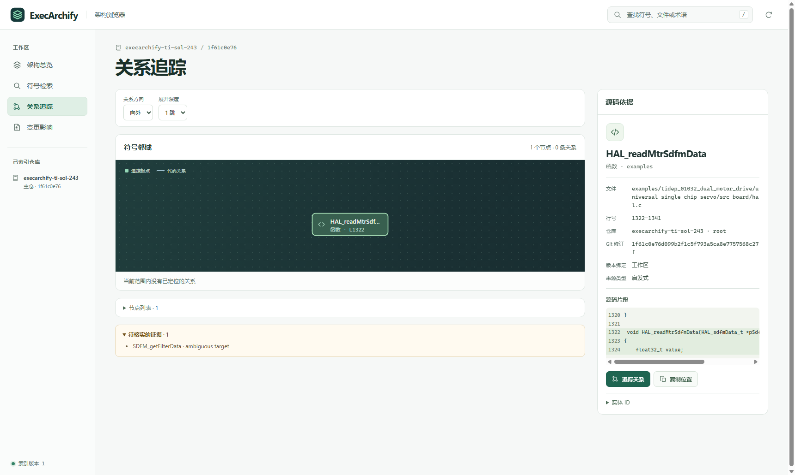
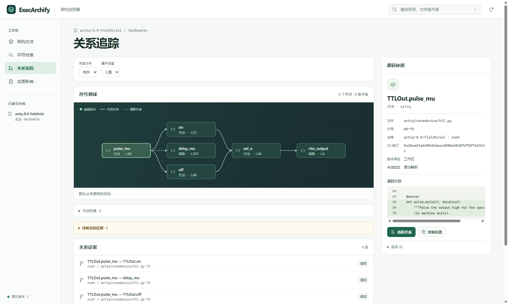

# ExecArchify 0.1.0 工业控制仓零配置实测

2026 年 11 月 24 日，Windows。目标是检验一个初次接触仓库的 Agent 能否从自动生成的图理解设备分层、找到陌生术语的实现，并沿信号路径评估变更。

**当前版本能定位许多已知函数、展示部分局部调用。自动还原工业架构、控制面与实时执行的分工，以及跨协议、跨核的影响传播，尚未达到目标。** 最接近目标的 TI 双伺服样本里，四条实源支持的伺服链路均未进入图谱，其中两条是常规 C 调用。

## 样本和比较方法

Sol 子代理从公开项目和维护者文档中选择并实测 Klipper，随后补测 TI。主代理独立实测 ARTIQ，复查 TI 源码，并通过浏览器和独立 stdio MCP 进程复现三个仓的代表查询。每次执行 `init --no-watch` 只选一个主仓，仓内无 `.execarchify.json`，无公共仓和人工补边。架构名称与信号路径只用来判卷。整个实验只静态读取这些项目。

| 样本与固定提交 | 为什么选它 | 已索引文本文件 / 总符号 | 默认架构结果 |
|---|---|---:|---|
| [TI Motor Control SDK](https://github.com/TexasInstruments/motor-control-sdk/tree/1f61c0e76d099b2f1c5f793a5ca8e7757568c27f) | 双伺服设计含 FreeRTOS 通信、裸核 R5F 控制、PRU 固件及电流采样 | 2,259 / 15,910 | 7 个目录组。FreeRTOS 配置、控制和 HAL 同在 `examples`，C 驱动和 PRU 汇编同在 `source`。 |
| [Klipper v0.13.0](https://github.com/Klipper3d/klipper/tree/61c0c8d2ef40340781835dd53fb04cc7a454e37a) | 主机 Python 运动规划、C 快路径、MCU 调度、AVR GPIO | 2,102 / 453,518 | 9 个目录组。四种角色挤在 `klippy` 和 `src` 两组，`lib` 占全部符号的 93.5%。 |
| [ARTIQ 8.0](https://github.com/m-labs/artiq/tree/9e28ee63a6d9b3bdaac6888e40287d75572d353c) | 主机调度、分布式主从设备、Rust 固件、实时 I/O 和 FPGA 门级逻辑 | 746 / 8,267 | 5 个目录组。`artiq` 一组含 7,934 个符号，调度器、设备驱动和逻辑硬件都在其中。 |

三个仓的“分组关系”初始查询均扫描 2,000 条引用、返回 0 条跨组关系，并标明截断。总览图上的树枝表示文件归组。ARTIQ 的 Archify 全量导出也只有 5 个组件、0 条符合导出条件的连接。Klipper 的 453,518 个符号中，宏有 410,535 个，函数和方法合计 7,129 个。[ARTIQ 总览实图](artiq-architecture.png) · [逐项测量](measurements.json)

Klipper 的全量 Archify 导出单独计时，到 15 分 20 秒仍未生成输出，随后按本次 15 分钟的实验上限停止。该结果只记录耗时下界，Klipper 全量导出的连接数未知。[ARTIQ 实际导出的 IR](artiq.archify.json)

## 从控制器到硬件，图能走多远

**TI 双伺服。** 官方设计把 EtherCAT 从站栈放在 FreeRTOS R5F，把两路控制环放在另一 R5F，并用 PRU 处理采样和编码器。这个公开仓提供控制、HAL、PRU 源码及通信工程配置。部分 CiA402 实现由工程文件从另一个 SDK 引入，主站在仓外。只索引主仓时，就应把这些位置显示为外部依赖。[TI 官方设计](https://software-dl.ti.com/processor-industrial-sw/esd/motor_control_sdk/am243x/2025_00_00_06/docs/api_guide_am243x/EXAMPLE_TIDEP_01032_REFERENCE_DESIGN.html) · [从外部 SDK 引入的源文件](https://github.com/TexasInstruments/motor-control-sdk/blob/1f61c0e76d099b2f1c5f793a5ca8e7757568c27f/examples/tidep_01032_dual_motor_drive/universal_single_chip_servo/am243x-lp-BP-AM2BLDCSERVO/r5fss1-0_freertos/ti-arm-clang/example.projectspec#L151-L165)

| TI 源码中的关系 | 零配置实测 |
|---|---|
| 同文件的 `motor1CtrlISR → motorCtrlISR` | 找到 1/1，返回调用行 1338，标识为启发式解析。 |
| `motorCtrlISR → HAL_readMtrSdfmData → SDFM_getFilterData` | 两段跨模块 C 调用均报告同名歧义。HAL 源码分别在 1327、1331、1335 行调用驱动，实际邻域只剩 HAL 自己一个节点。 |
| PRU 采样写入共享缓冲，随后触发 R5F 中断 | 两种跨核关系均缺失。`sdfm.asm` 可以按文本定位，`END_RESET_NC_FRAME` 标签没有实体 ID，反查 R5F 端也找不到 PRU 来源。 |
| 同仓独立 SDFM 示例中的 FreeRTOS 任务 | `main` 和 `freertos_main` 均可定位，`xTaskCreateStatic` 注册的回调没有边。该示例与双伺服的 EtherCAT 任务分别核对。 |

上表覆盖双伺服链路 4 条、同文件对照 1 条及独立任务注册 1 条。四个伺服 C 函数和独立示例的两个 C 函数都有节点，另选的一个 PRU 汇编标签缺失。[中断入口和控制调用](https://github.com/TexasInstruments/motor-control-sdk/blob/1f61c0e76d099b2f1c5f793a5ca8e7757568c27f/examples/tidep_01032_dual_motor_drive/universal_single_chip_servo/src_control/motor1_drive.c#L1335-L1367) · [HAL 的三次读取](https://github.com/TexasInstruments/motor-control-sdk/blob/1f61c0e76d099b2f1c5f793a5ca8e7757568c27f/examples/tidep_01032_dual_motor_drive/universal_single_chip_servo/src_board/hal.c#L1322-L1336) · [PRU 的写入与中断](https://github.com/TexasInstruments/motor-control-sdk/blob/1f61c0e76d099b2f1c5f793a5ca8e7757568c27f/source/current_sense/sdfm/firmware/sdfm.asm#L876-L883) · [R5F 中断注册](https://github.com/TexasInstruments/motor-control-sdk/blob/1f61c0e76d099b2f1c5f793a5ca8e7757568c27f/examples/tidep_01032_dual_motor_drive/universal_single_chip_servo/sys_main.c#L249-L256) · [FreeRTOS 注册](https://github.com/TexasInstruments/motor-control-sdk/blob/1f61c0e76d099b2f1c5f793a5ca8e7757568c27f/examples/current_sense/icss_sdfm_nine_channel_load_share_continuous_mode/am243x-lp/r5fss0-0_freertos/main.c#L50-L75)



**Klipper。** 用路径和限定名能定位全部 11 个选定函数，只给函数短名时有 8/11 进入检索前五。抽查的 7 条关系中，四条直接 C 调用命中 1 条，两条动态绑定和一条主机到 MCU 的命令协议均未命中。唯一命中的被测边为 `stepper_event → stepper_event_avr`。浏览器能画出三个实现分支，但条件编译后的板级路径尚需源码核对。这 7 次一跳查询都未被截断。[Klipper 官方运行路径说明](https://www.klipper3d.org/Code_Overview.html) · [主机命令格式](https://github.com/Klipper3d/klipper/blob/61c0c8d2ef40340781835dd53fb04cc7a454e37a/klippy/stepper.py#L108-L116) · [MCU 命令注册](https://github.com/Klipper3d/klipper/blob/61c0c8d2ef40340781835dd53fb04cc7a454e37a/src/stepper.c#L234-L265) · [板级分支实图](klipper-functions.png)

**ARTIQ。** 按源码行核对，9/9 个选定定义都有图节点，短名检索前五命中 7/9。按文件与索引限定名可唯一选择 8/9，同一 Rust 文件的两个条件编译分支共享 `imp.output` 名称。10 条代表性关系中出现 7 条，覆盖类内调用、显式导入、Rust 辅助函数和 FPGA 接口构造。主机设备对象分派、调度对象分派，以及 Python 系统调用到 Rust 实现的符号绑定均缺失。最后一项在固件表第 148 行有明确的映射。构造 FPGA 接口这条边只证明构造关系，硬件信号连线还需独立证据。[官方实时 I/O 架构](https://m-labs.hk/artiq/manual/rtio.html) · [驱动调用](https://github.com/m-labs/artiq/blob/9e28ee63a6d9b3bdaac6888e40287d75572d353c/artiq/coredevice/ttl.py#L48-L75) · [固件符号绑定](https://github.com/m-labs/artiq/blob/9e28ee63a6d9b3bdaac6888e40287d75572d353c/artiq/firmware/ksupport/api.rs#L145-L151) · [逻辑硬件输出](https://github.com/m-labs/artiq/blob/9e28ee63a6d9b3bdaac6888e40287d75572d353c/artiq/gateware/rtio/phy/ttl_simple.py#L19-L33)



当前“函数点云”的交互是从一个符号展开的局部有向图。ARTIQ 的截图有 6 个节点、6 条边。UI 单幅最多渲染 30 个节点和 60 条关系。若验收要求是全仓函数先按架构聚类、再缩放到函数，当前界面尚未具备这一级视图。[图布局实现](../../../execarchify/static/graph.js)

## 陌生术语和修改影响

| 从 Agent 入口提出的问题 | 观察结果 |
|---|---|
| Klipper 的 `queue_step` 在哪里实现 | 前五全部为 CI 工作流里的 `steps` 配置键。五个英文命令词、近似拼写或概念查询均未把预期实现排进前五，中文“步进脉冲调度”无结果。 |
| ARTIQ 的实时下溢、数字脉冲和卫星接收在哪里实现 | `RTIOUnderflow` 和少一个字母的 `RTIOUnderflw` 均排第一。`time-stamped digital pulse` 将 TTL 驱动排第二。`satellite auxiliary packet` 找到了相关协议枚举，但指定的卫星接收函数不在前五。中文“定时数字输出脉冲”无结果。 |
| ARTIQ 的一次真实驱动修改影响谁 | 对照历史提交，报告找到已修改的 `TTLOut.set_o`、直接调用者 `on/off`，以及二跳调用者 `pulse_mu`。这是逐行核过的一条成功传播。共列出 5 个候选测试，此次没有运行这些测试。 |
| Klipper 板级实现发生文本改动后会追到哪 | 隔离克隆给 `stepper_event_avr` 加一行内注释，报告识别到该符号，并列出一跳推测调用者，未继续追到二跳调度器。恢复后 Git 工作树干净，`impact` 仍将 24,530 行的 ASCII STL 报为修改。Git 对象为 LF，工作树为 CRLF，统一行尾后内容相同。 |

每项检索以事先指定的实现为目标。找到文档、协议类型或同名配置键可以给人线索，此处单独记录。以上分数来自刻意选取的硬件控制路径，不能外推成整仓召回率。本次没有执行固件、上板，也没有测量真实团队的上手时间。[ARTIQ 真实提交](https://github.com/m-labs/artiq/commit/fae95e73ada0e541383429fe4ef67ee114715951) · [逐查询结果与影响清单](measurements.json)

## 下一版应先通过的验收

1. 用构建目标、CPU、OS、链接工程和产物路径给出可核查的架构分组。在 TI 中分出 FreeRTOS 通信工程、裸核控制和 PRU 固件，并把外置 SDK 标为仓外。把分组方式带回另一个仓复测，保持规则通用。
2. 先打通一条短链，再增加图的密度。以 TI 的“PRU 共享缓冲／中断 → R5F → HAL → 驱动”为验收，分别解决 C 声明与实现消歧、任务或中断回调、汇编标签和硬件信号证据。以 Klipper 命令注册和 ARTIQ 固件映射作跨项目对照。
3. 保留真实失败查询作为检索回归样例。至少让 Klipper 的 `queue_step` 在前五给出协议两端的源码。把 Git 干净时的大文件行尾误报作为影响分析的独立回归项。

## 复现

在各上游仓检出表中固定提交，在已安装 ExecArchify 的环境执行以下命令。把下例路径替换为对应克隆的位置。默认观察进程通过 `--no-watch` 关闭，检索、追踪与浏览器仍共用正常查询内核。

```powershell
execarchify init C:/samples/artiq --no-watch
execarchify context --workspace C:/samples/artiq --architecture
execarchify trace 'artiq/coredevice/ttl.py#TTLOut.pulse_mu' --workspace C:/samples/artiq --direction out --depth 3 --limit 30

execarchify init C:/samples/klipper --no-watch
execarchify resolve queue_step --workspace C:/samples/klipper --limit 5

execarchify init C:/samples/motor-control-sdk --no-watch
execarchify trace 'examples/tidep_01032_dual_motor_drive/universal_single_chip_servo/src_board/hal.c#HAL_readMtrSdfmData' --workspace C:/samples/motor-control-sdk --direction out --depth 1 --limit 150

execarchify serve --workspace C:/samples/artiq --no-watch
```

历史影响样例的 base 是 `3d0c3cc1cf84a1b6688afa4b41ba0c7789717915`，head 是 `fae95e73ada0e541383429fe4ef67ee114715951`。浅克隆可先运行 `git fetch --depth 2 origin fae95e73ada0e541383429fe4ef67ee114715951`，再将两端传给 `execarchify impact --base … --head … --depth 2 --limit 100`。完整的样例输入、源码锚点、排名、截断标记和浏览器节点数保存在 [测量文件](measurements.json)。
